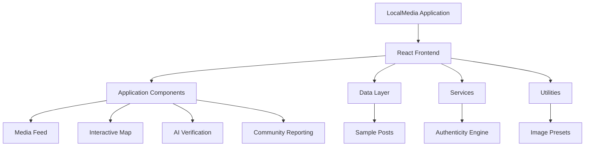
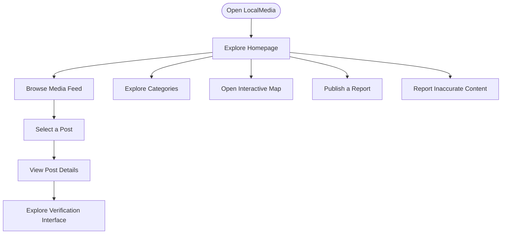

# 🌐 LocalMedia

### Discover. Verify. Report. Stay Informed.

**LocalMedia** is a modern, interactive media platform designed to bring local information, community reporting, and media authenticity tools together in one place.

It provides a clean interface for exploring media posts, discovering content through categories, viewing location-based information, and accessing AI-assisted content verification.

<p align="center">
  
  
  
  
</p>

<p align="center">
  <a href="#-features">Features</a> •
  <a href="#-technology-stack">Technology</a> •
  <a href="#-installation">Installation</a> •
  <a href="#-project-structure">Structure</a> •
  <a href="#-roadmap">Roadmap</a> •
  <a href="#-contributing">Contributing</a>
</p>

---

## 📌 Table of Contents

<details>
<summary><strong>Click to expand navigation</strong></summary>

1. [About the Project](#-about-the-project)
2. [Features](#-features)
3. [Technology Stack](#-technology-stack)
4. [Project Architecture](#-project-architecture)
5. [Installation](#-installation)
6. [Running Locally](#-running-locally)
7. [Project Structure](#-project-structure)
8. [Application Modules](#-application-modules)
9. [Development Roadmap](#-roadmap)
10. [Contributing](#-contributing)
11. [Git Workflow](#-git-workflow)
12. [License](#-license)

</details>

## 🎯 About the Project

LocalMedia aims to create a unified digital environment where users can explore local media content, interact with location-based information, and access tools designed to help assess the authenticity of published content.

The project focuses on:

- Accessible information discovery.
- Interactive content exploration.
- Community-driven reporting.
- AI-assisted media verification.
- Simple and responsive user experience.

## ✨ Features

### 📰 Media Feed

- Feed-based content presentation.
- Individual post cards.
- Post detail view.
- Category-based content exploration.
- Interactive content interface.

### 🗺️ Interactive Map

- Location-oriented content visualization.
- Interactive map interface.
- Geographical content exploration.

### 🤖 AI Verification

- AI verification interface.
- Content authenticity assessment workflow.
- Dedicated verification modal.
- Explanation interface for AI-assisted results.

*Actual verification accuracy depends on the underlying verification implementation and data sources.*

### 📢 Community Reporting

- Report publishing interface.
- Inaccurate content reporting interface.
- User-facing notifications.
- Content interaction workflows.

### 🎨 User Experience

- Modern React component architecture.
- Responsive interface.
- Reusable UI components.
- Interactive modals.
- Clean and maintainable TypeScript code.

## 🛠️ Technology Stack

| Technology | Purpose |
|---|---|
| React | Frontend UI |
| TypeScript | Type safety |
| Vite | Development and build tooling |
| CSS | Interface styling |
| JavaScript | Application logic |
| npm | Package management |

## 🏗️ Project Architecture



## 🚀 Installation

### Prerequisites

Install the following:

- Node.js (LTS recommended)
- npm
- Git
- Visual Studio Code (recommended)

Check your installation:

```bash
node --version
npm --version
git --version
```

### Clone the repository

```bash
git clone https://github.com/Shankar1234566/LocalMedia.git
```

### Enter the project directory

```bash
cd LocalMedia
```

### Install dependencies

```bash
npm install
```

## ▶️ Running Locally

Start the Vite development server:

```bash
npm run dev
```

Open the local URL displayed in your terminal.

Usually:

```text
http://localhost:5173/
```

### Production build

```bash
npm run build
```

### Preview production build

```bash
npm run preview
```

## 📂 Project Structure

```text
LocalMedia/
│
├── public/
│   ├── favicon.svg
│   └── icons.svg
│
├── src/
│   ├── assets/
│   │   ├── hero.png
│   │   ├── react.svg
│   │   └── vite.svg
│   │
│   ├── components/
│   │   ├── AIVerificationModal.tsx
│   │   ├── CategoryFilterBar.tsx
│   │   ├── ExplainAIModal.tsx
│   │   ├── FeedListView.tsx
│   │   ├── Header.tsx
│   │   ├── HeroBanner.tsx
│   │   ├── InteractiveMapView.tsx
│   │   ├── PostCard.tsx
│   │   ├── PostDetailModal.tsx
│   │   ├── PublishReportModal.tsx
│   │   ├── ReportInaccurateModal.tsx
│   │   └── Toast.tsx
│   │
│   ├── data/
│   │   └── samplePosts.ts
│   │
│   ├── services/
│   │   └── authenticityEngine.ts
│   │
│   ├── types/
│   │   └── index.ts
│   │
│   ├── utils/
│   │   └── imagePresets.ts
│   │
│   ├── App.css
│   ├── App.tsx
│   ├── index.css
│   └── main.tsx
│
├── index.html
├── package.json
├── package-lock.json
├── README.md
└── .gitignore
```

*Generated dependency folders such as node_modules are excluded from the project structure.*

## 🧩 Application Modules

| Module | Component |
|---|---|
| Main application | App.tsx |
| Navigation | Header.tsx |
| Homepage banner | HeroBanner.tsx |
| Content categories | CategoryFilterBar.tsx |
| Media feed | FeedListView.tsx |
| Individual posts | PostCard.tsx |
| Post details | PostDetailModal.tsx |
| Interactive map | InteractiveMapView.tsx |
| AI verification | AIVerificationModal.tsx |
| AI explanation | ExplainAIModal.tsx |
| Publish reports | PublishReportModal.tsx |
| Report inaccuracies | ReportInaccurateModal.tsx |
| Notifications | Toast.tsx |

## 📸 Screenshots

Add actual screenshots of the running application here.

| Homepage | Media Feed |
|---|---|
| Add homepage screenshot | Add feed screenshot |

| Interactive Map | AI Verification |
|---|---|
| Add map screenshot | Add verification screenshot |

## 🔄 Application Workflow



## 🗺️ Development Roadmap

- [x] React and TypeScript project structure
- [x] Media feed components
- [x] Category filter component
- [x] Post detail interface
- [x] Interactive map component
- [x] AI verification interface
- [x] Community reporting interfaces
- [ ] Production-ready backend integration
- [ ] Database integration
- [ ] User authentication
- [ ] Real-time content updates
- [ ] Advanced AI verification integration
- [ ] Automated testing
- [ ] Production deployment

*Roadmap items indicate development goals, not necessarily completed functionality.*

## 🤝 Contributing

Contributions are welcome!

1. Fork the repository.
2. Create a feature branch.
3. Make your changes.
4. Test your changes.
5. Commit your work.
6. Push your branch.
7. Open a Pull Request.

### Contribution commands

```bash
git checkout -b feature/your-feature-name

git add .

git commit -m "Add: describe your contribution"

git push origin feature/your-feature-name
```

Open a Pull Request for review.

## 🌱 Git Workflow

We encourage meaningful contributions and maintainable development practices.

- Use descriptive commit messages.
- Keep changes focused.
- Avoid committing generated dependencies.
- Document important changes.
- Review code before merging.
- Include relevant screenshots for UI changes.

## 🔐 Security

- Never commit API keys or credentials.
- Store secrets in environment variables.
- Validate user-submitted content.
- Review third-party dependencies.
- Report security vulnerabilities privately to the repository maintainer.

## 📄 License

A license has not yet been specified. Check the repository for licensing terms before redistributing or reusing this project.

## 👨‍💻 Maintainer

**Shankar
